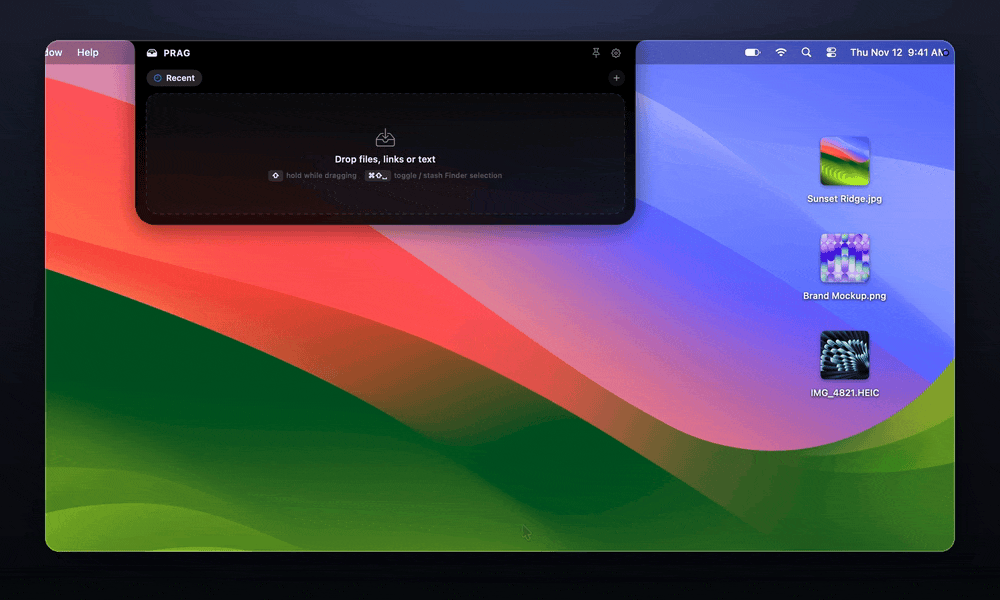
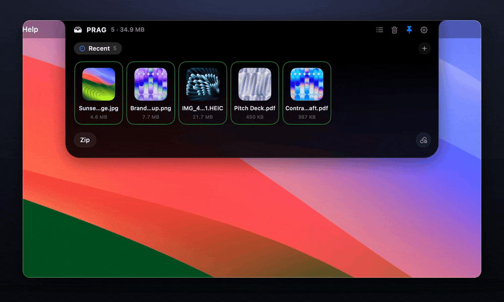
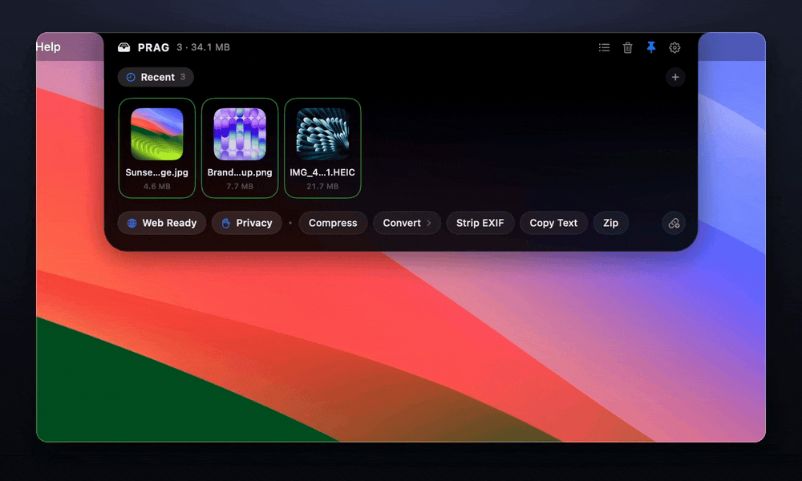
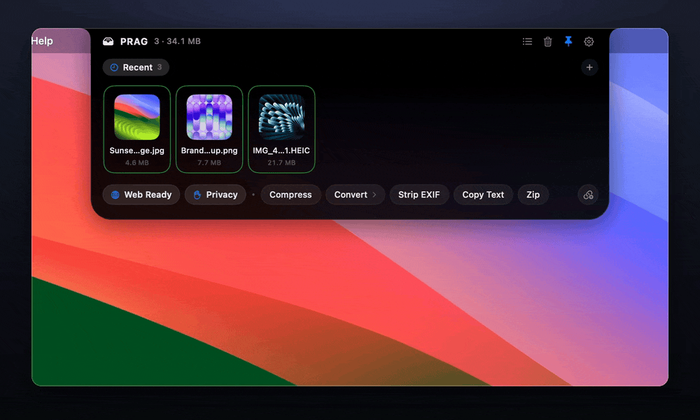
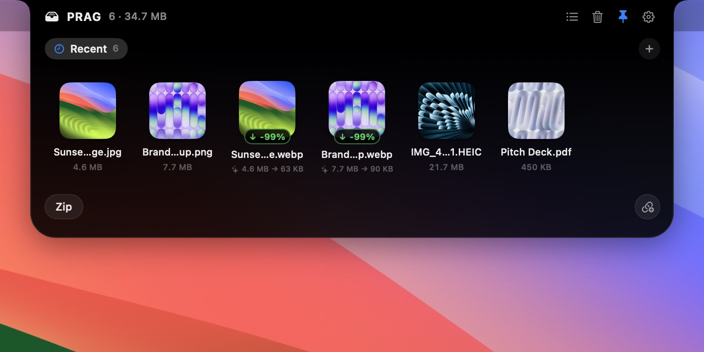
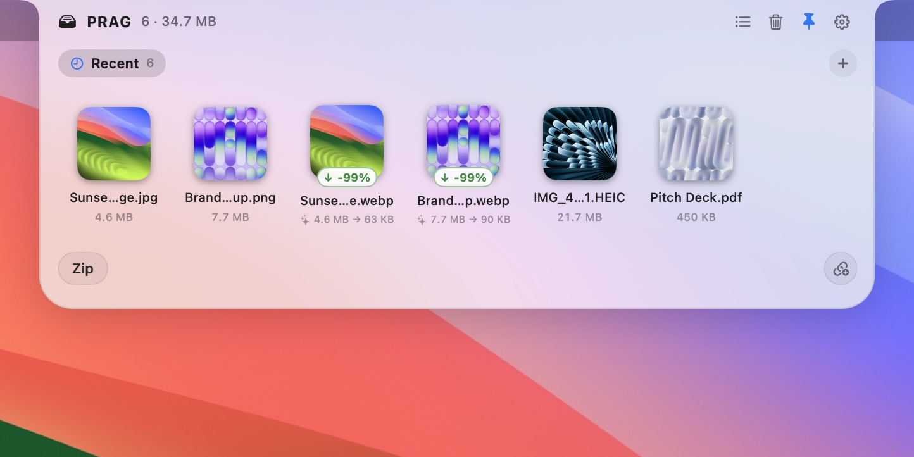
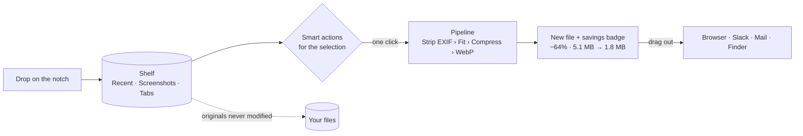

<p align="center">
  
</p>

<p align="center">
  
  
  
  
  
</p>

<p align="center">
  <b>Drop anything on the notch. Act on it in one click. Drag the result where it needs to go.</b><br>
  <sub>No music player. No calendar. No widgets. Just the fastest place on your Mac to put a file down.</sub>
</p>

<p align="center">
  <a href="#park">Park</a> ·
  <a href="#retrieve">Retrieve</a> ·
  <a href="#act">Act</a> ·
  <a href="#go">Go</a> ·
  <a href="#install">Install</a> ·
  <a href="#under-the-hood">Under the hood</a>
</p>


---

<p align="center">
  
</p>

---

## Why PRAG

Every notch app wants to be a dashboard. PRAG wants to be **a workbench**.

You're dragging a screenshot into Slack, a stack of PDFs into a portal, a 9 MB photo into a CMS that wants 500 KB. Somewhere between "here" and "there" the file needs a place to wait and a quick fix. That place is the black rectangle you look at all day.

- **The notch is the shelf.** It opens as you drag toward it, then melts back into the camera housing.
- **One click, one chain.** *Web Ready* strips EXIF, fits to 2400 px, compresses and converts to WebP in a single pass.
- **Originals are sacred.** Every action writes a **new** file next to the source, with a badge showing exactly what you saved.
- **It feels like macOS.** Native AppKit + SwiftUI, system colours, light & dark, zero focus-stealing.


---

## Park

> *Put it down without thinking about where.*

Drag anything toward the top of the screen: files, folders, links, text, images out of a browser. The notch swells as you approach, opens within 60 pt and catches the drop. Walk away and it tucks back in, leaving a tiny stack and a count beside the camera.

| Trigger | How |
|---|---|
| **Drag toward the notch** | Opens as you get close, with a magnetic glow and a haptic tick |
| **Hold <kbd>⇧</kbd> mid-drag** | Dragging somewhere else? Hold Shift for 70 ms and the shelf opens |
| **<kbd>⌘</kbd><kbd>⇧</kbd><kbd>Space</kbd>** | Toggle the shelf, or stash whatever is selected in Finder |
| **Hover** | Rest the pointer on the notch |
| **Shake** *(optional)* | Wiggle the cursor while dragging |
| **Auto-Catch screenshots** | New screenshots land on the shelf the instant you take them |

On an external display PRAG lives in a slim pill at the top centre, so it works the same way everywhere.


---

## Retrieve

> *Everything you parked, organised the moment you need it.*

<p align="center">
  
</p>

- **Recent** is where new drops land. **Screenshots** collects auto-caught captures.
- **Tabs** are yours: select a few items and hit **Tab from Selection**, or drag tiles onto any tab.
- Double-click a tab to rename it. Deleting a tab sends its items back to Recent; nothing is lost.
- <kbd>Space</kbd> Quick Look · <kbd>⌘</kbd><kbd>A</kbd> select all · <kbd>⌫</kbd> remove from shelf · <kbd>⌘</kbd><kbd>C</kbd> copy files · <kbd>⌘</kbd><kbd>V</kbd> paste into the shelf
- The shelf survives restarts, and removing an item never touches the file on disk.


---

## Act

> *The right actions for what's selected, plus one-click chains.*

<p align="center">
  
</p>

PRAG looks at what you've selected (or the whole tab) and offers only what makes sense:

| Selection | Actions |
|---|---|
| 🖼 **Images**: PNG, JPG, HEIC, TIFF, WebP | Compress · Convert → WebP / PNG / JPG / HEIC / AVIF · Strip EXIF & GPS · Copy Text (on-device OCR) |
| 📄 **PDFs** | Merge · Compress · Extract text · Extract pages as images |
| 🎞 **Video**: MP4, MOV | Compress 720p / 1080p · Extract audio (.m4a) · Convert to GIF |
| 🗂 **Batches, folders & code** | Zip · *right-click:* Open in Cursor / VS Code / Terminal |

**Presets** chain several steps into one click:

| Preset | Chain |
|---|---|
| 🌐 **Web Ready** | Strip EXIF › Fit 2400 px › Compress › WebP |
| ✋ **Privacy** | Strip EXIF › JPG |
| 📨 **Submission Ready** | Merge PDFs › Compress PDF |
| 💬 **Share Clip** | Compress to 720p |

Or press **🔗** to build your own 2–3 step chain on the spot. Every run shows a live progress ring you can cancel, and lands as a **new** item with a savings badge, e.g. <code>↓ −64% · 5.1 MB → 1.8 MB</code>.


---

## Go

> *Drag the result straight into wherever it's going.*

Drag one tile, or a whole multi-selection from different folders, out of the notch into a browser upload, Slack, Mail, Figma or Finder. It's a real multi-item drag, so ten files from four folders leave in one gesture. Right-click any tile to Open, Reveal in Finder, Copy, Move to a tab, or Remove.


---

## Looks like it shipped with your Mac

<p align="center">
  
</p>

<table>
  <tr>
    <td width="50%"></td>
    <td width="50%"></td>
  </tr>
  <tr>
    <td align="center"><sub>Dark</sub></td>
    <td align="center"><sub>Light</sub></td>
  </tr>
</table>

**Auto** follows your Mac's appearance live; Light and Dark are there if you want to pin one. Collapsed, the shelf stays pure black in both, so it disappears into the camera housing.


---

## Small, quiet, fast

| | |
|---|---|
| **Idle CPU** | 0.0 %, with no polling while you aren't dragging |
| **Memory** | ~20–23 MB physical footprint |
| **Binary** | ~3 MB, native arm64 |
| **Open** | ~0.2 s from hover to a fully drawn shelf |
| **Clicks** | Never blocks the menu bar: the collapsed notch is fully click-through |
| **Focus** | Never steals it: a non-activating panel on every Space, including over full-screen apps |


---

## Install

**Requirements:** macOS 14 Sonoma or later on Apple Silicon, plus a Swift 6 toolchain (Xcode 16+ or the matching Command Line Tools).

```sh
git clone https://github.com/kidraah/PRAG.git
cd PRAG
make run        # build, bundle build/PRAG.app, launch
```

| Command | |
|---|---|
| `make app` | Build and ad-hoc sign `build/PRAG.app` |
| `make run` | Build, then (re)launch the app |
| `make test` | Run the test suite (works with Command Line Tools only) |
| `make dmg` | Package `build/PRAG.dmg` |

PRAG lives in the menu bar (no Dock icon). The first time you stash a Finder selection with the hotkey, macOS asks to let PRAG control Finder; that's the only permission it needs.


---

## Privacy

PRAG is **local-only**. It makes no network requests and has no analytics or accounts. OCR runs on-device through Apple's Vision framework. Files are read from where you dropped them; processed outputs go to `~/Library/Application Support/PRAG/Workspace` and are cleaned up when you remove them from the shelf.

While *Auto-Catch screenshots* is on, PRAG turns off macOS's floating screenshot thumbnail (which otherwise holds new files back for about 5 seconds), and restores your previous setting when you turn it off.


---

## Under the hood



```
Sources/
├── PRAGCore/                 pure Swift, no UI, fully unit-tested
│   ├── Models/               StashedItem, ActionPipeline, ByteDelta
│   └── Services/             ImageIO + libwebp · PDFKit · AVFoundation · Vision
│                             PipelineChainer · StashStorage · ScreenshotWatcher
└── PRAG/                     the app
    ├── WindowServer/         non-activating NSPanel, notch geometry, hit-testing
    ├── InputMonitors/        drag proximity, Shift-hold, shake, Carbon hotkey
    ├── UI/                   SwiftUI shelf: silhouette, tray, tabs, actions
    └── Demo/                 scripted scenes used to record this README
```

- **Notch geometry** comes from `NSScreen.safeAreaInsets` and the auxiliary top areas, so the silhouette matches the real camera housing on every notched MacBook.
- **Pipelines** are declarative chains of steps. Per-file steps fan out, merge/zip steps fan in, and every output carries its lineage and byte delta.
- **No permissions theatre.** Drag detection uses public `NSEvent` monitors and the drag pasteboard, and the hotkey uses Carbon. No Accessibility or Input Monitoring prompts.

<details>
<summary><b>How the media in this README is made</b></summary>

---

Everything above is real app footage, not mock-ups. `PRAG --demo <scene>` plays a scripted scene on a throwaway shelf over a clean wallpaper, drives a virtual cursor to real controls, and logs camera keyframes. Two scripts turn that into the clips:

```sh
make app
scripts/readme-media/make-samples.sh /tmp/prag-samples                    # sample files from macOS wallpapers
scripts/readme-media/record.sh park /tmp/prag-samples /tmp/prag-rec       # also: act, sort, theme
python3 scripts/readme-media/render.py /tmp/prag-rec/park.mov /tmp/prag-rec/park.json docs/media/park
python3 scripts/readme-media/banner.py                                     # docs/media/banner.svg
```

`render.py` syncs on a one-frame marker, replays the camera as an eased zoom-and-follow, frames the footage in a rounded window, and encodes MP4 + GIF (needs ffmpeg, gifski, Pillow and NumPy).
</details>


---

## License

[MIT](LICENSE) © PRAG contributors

<p align="center"><sub>Park · Retrieve · Act · Go</sub></p>
